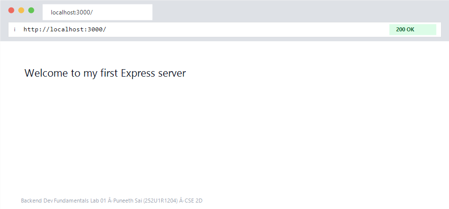
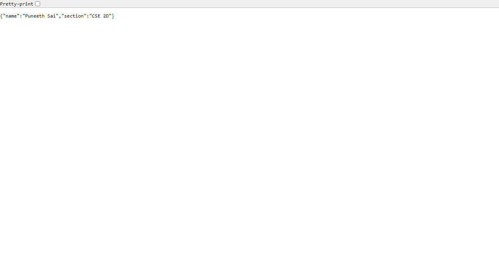
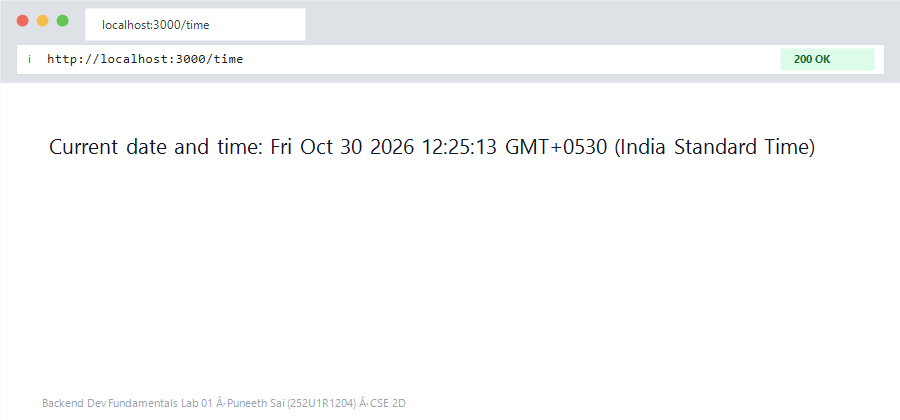

# Lab 1: Node.js and Express server

Puneeth Sai · 252U1R1204 · CSE 2D

**Live link:** https://YOUR-APP-NAME.onrender.com

## Project structure

```
lab-01/
├── app.js            main Express file
├── http-server.js    server using only the built-in http module
├── routes/
│   ├── main.js       /, /about, /time, /hello/:name, /info, /error
│   └── students.js   all /students routes
└── package.json
```

## How to run

```bash
cd lab-01
npm install
npm start
```

The server runs on port 3000 by default. No environment variables are needed
(`PORT` is optional and is set automatically when deployed).

To run the plain `http` version (no Express): `npm run http`

## Endpoints

| Method | Path | Description | Status |
|--------|------|-------------|--------|
| GET | / | Welcome text | 200 |
| GET | /about | JSON with name and section | 200 |
| GET | /time | Current date and time | 200 |
| GET | /hello/:name | Says hello using a route parameter | 200 |
| GET | /info | Shows method, url and query of the request | 200 |
| GET | /error | Throws an error on purpose | 500 |
| GET | /students | List of students (optional `?name=Ravi`) | 200 |
| GET | /students/:id | One student by position (0, 1, 2) | 200 or 404 |
| POST | /students | Create a student | 201 |
| PUT | /students/:id | Update a student | 200 |
| DELETE | /students/:id | Delete a student | 200 |
| GET | any other path | Not Found | 404 |

POST, PUT and DELETE can be tested with Postman (browsers only send GET
when you type a URL).

## Screenshots








## Notes

Write your own notes here: any problems you faced and how you solved them.
